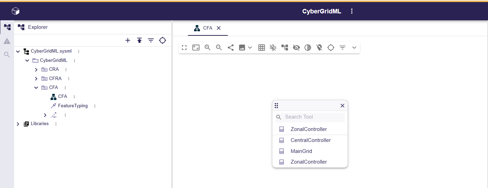
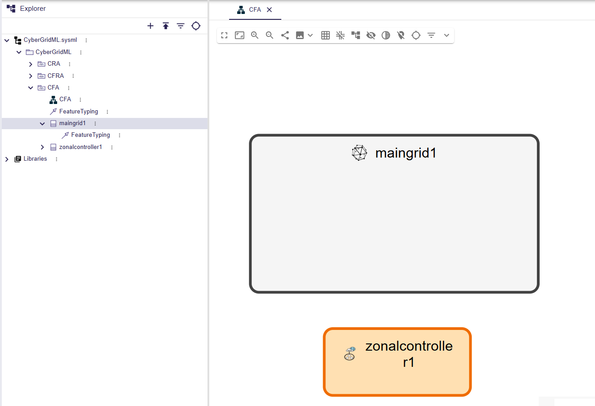
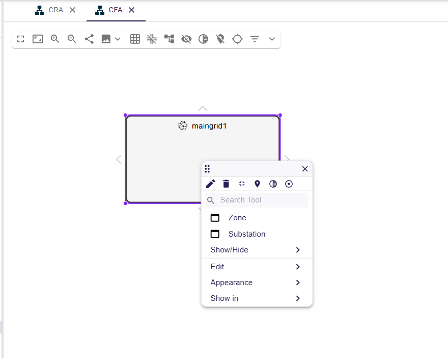
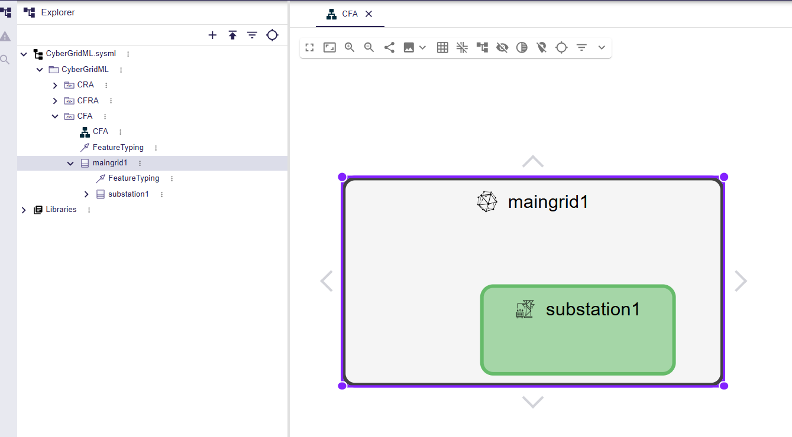
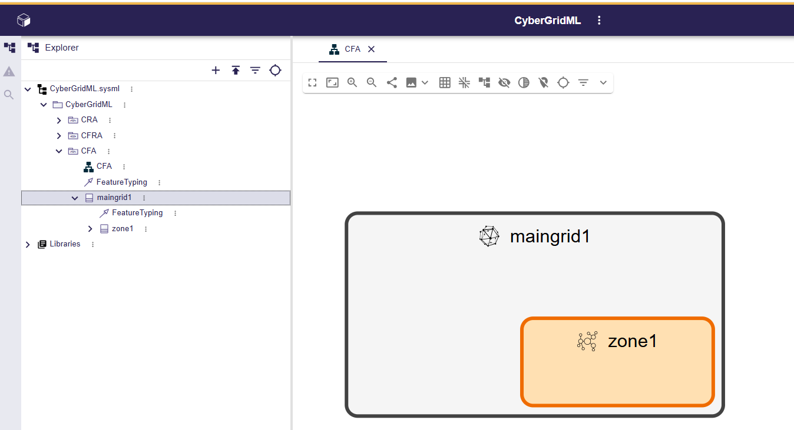
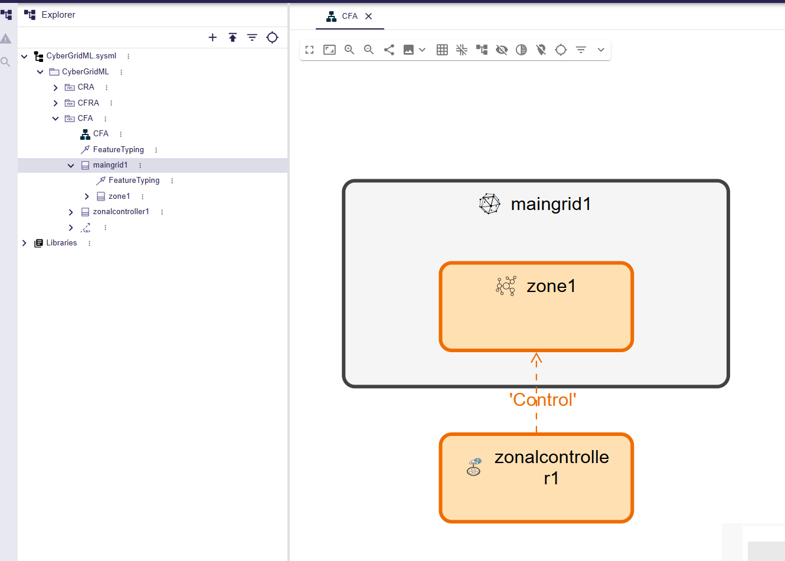
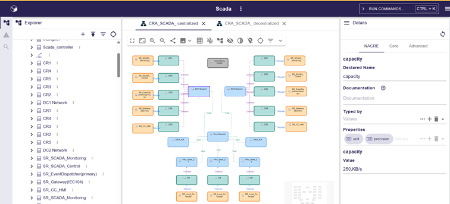

# CyberGridML Project Creation

CyberGridML is based on the **SysON** tool. To create a new project, the user selects the **CyberGridML** template, as illustrated in **Figure 1**.

*Figure 1 – Creation of a new project*

---

# 1. CFA Creation

A dedicated diagram allows users to create and display the **CFA**.

As a reminder, the user must first create the following mandatory elements:

- **MainGrid**
- **CentralController**
- **ZonalController**
- **Zone**
- **Substation**

Additional control elements can then be created as needed.

*Figure 2 – CFA elements are added to the view using pop-up context menus*

The user must also specify the structure to which each controller is associated. Once all controllers have been defined, the CFA is complete.

An example of a simple CFA for a SCADA system is shown in **Figure 3**.

*Figure 3 – SCADA CFA*

In the CFA , we can create also ZonalController , as shown in **Figure 4**.

*Figure 4 – ZonalController in CFA*

In a maingrid, you can create zones and substations, as shown in **Figure 5**.

*Figure 5 – Maingrid children*

Highlighting the creation of a Substation in maingrid.

*Figure 6 – Substation in Maingrid*

Highlighting the creation of a zone in maingrid.

*Figure 7 – Zone in Maingrid*

Link a zone to a ZonalController via the Control Link.

*Figure 8 – Zone-ZonalController Link*

---

# 2. CRA Creation

A dedicated diagram allows users to create and display the communication and computing resources of the **CRA**.

As illustrated in **Figure 4**, the following element types can be created:

- **CommunicationMedia** (displayed in blue)
- **ComputingResource** (displayed in green)
- **RedundancyCluster** (displayed in gray)
- **SoftwareResource** (displayed in yellow)

The colors help users quickly identify the different element types within the diagram.

*Figure 9 – Menu showing which elements the user can create in a CRA*

Once these resources have been created, they must be linked together to describe the system architecture:

- Each **SoftwareResource** must be allocated to a **ComputingResource**.
- A **SoftwareResource** may optionally belong to a **RedundancyCluster**.
- Each **ComputingResource** must be connected to at least one **CommunicationMedia**, and may be connected to several.
- **CommunicationMedia** can be connected together to represent the communication network.

A complete CRA for a decentralized SCADA system is illustrated in **Figure 5**.

*Figure 10 – CRA example for a modular SCADA system*

Each CRA component has properties whose values can be configured by the user. The **Details** tab, located on the right-hand side of the window, displays the name, documentation, type, and properties of the selected element.

*Figure 11 – Details tab*

Property values can be edited directly from this panel, as illustrated in **Figure 7**.

*Figure 12 – Filling in capacity value in the Details tab*

---

# 3. Hazards Definition

Hazards are properties associated with CRA components. To define a hazard, the user must first select the target element, as illustrated in **Figure 8**.

*Figure 13 – Selection of DC1 Network*

The user can then apply a hazard to the selected element using the **Toggle Hazard** command, as shown in **Figure 9**.

*Figure 14 – Hazard application*

To make hazard assignments easily identifiable, elements carrying a hazard are displayed in **red**, as illustrated in **Figure 10**.

*Figure 15 – DC1 Network shown in red after hazard application*

Communication hazards include the following properties:

- Description
- Justification
- Percentage of lost messages
- Hazard occurrence period

Once a hazard has been applied to an element, its properties become visible in the **Model Explorer**, as shown in **Figure 11**.

*Figure 16 – Hazard properties are added to DC1 Network*