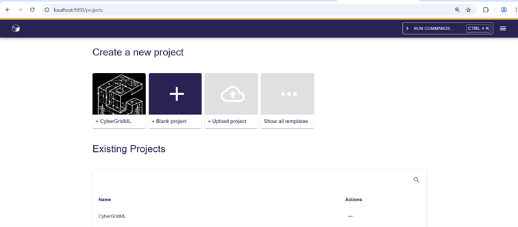
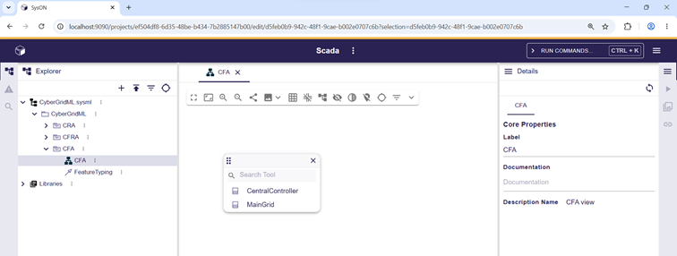
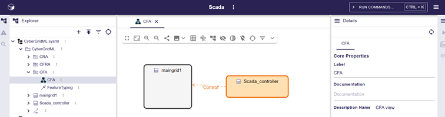
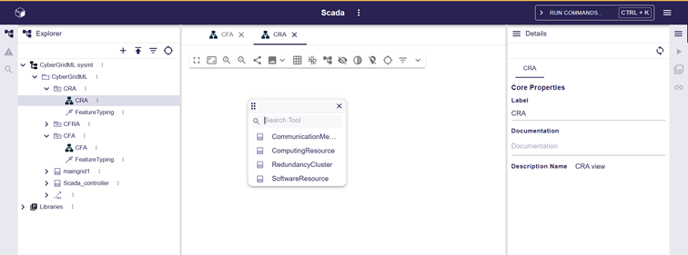
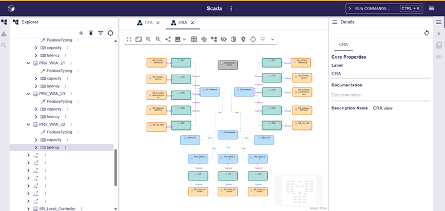
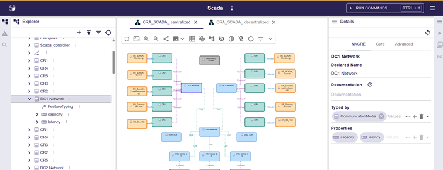
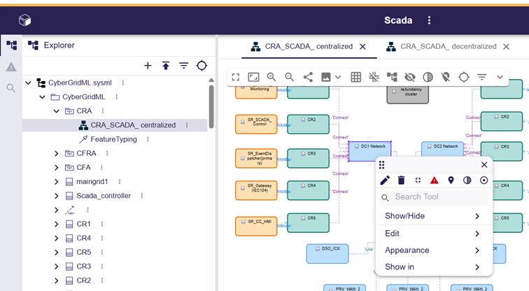
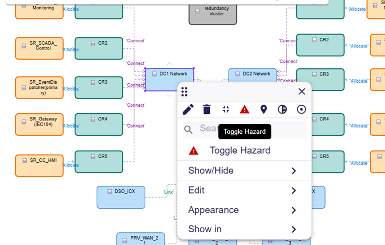
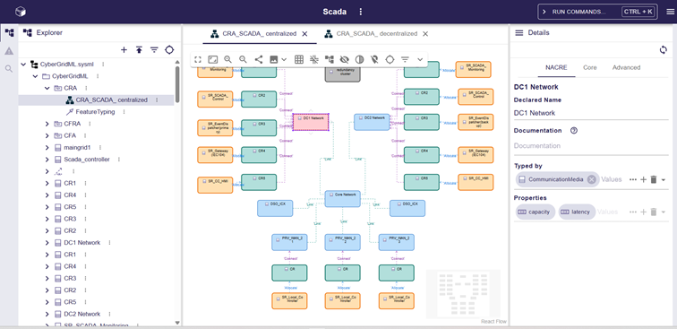
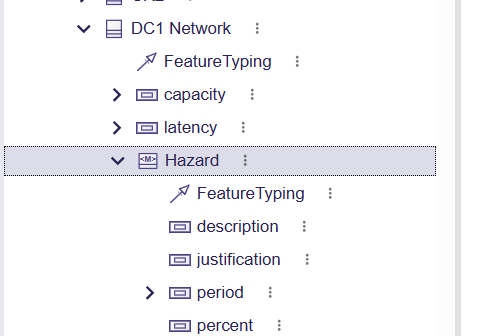

# Illustration des fonctionnalités de CyberGridML

Cette section présente les principales fonctionnalités de **CyberGridML** à travers un cas d'étude basé sur une architecture **SCADA**.

---

## 1. Création d'un projet CyberGridML

CyberGridML fournit un modèle de projet (*template*) construit sur **SysON**.

Tout au long de cette démonstration, nous nous appuyons sur un modèle **SCADA** afin d'illustrer les différentes fonctionnalités offertes par CyberGridML.

---

## 2. Création du CFA

La palette de création permet d'ajouter les différents éléments constituant un **Cyber Functional Architecture (CFA)**.

La figure suivante présente un exemple complet de CFA.

---

## 3. Création d'un CRA

La figure suivante met en évidence la palette dédiée à la création d'un **Cyber Risk Assessment (CRA)**.

L'exemple ci-dessous présente un CRA construit à partir du cas d'étude **SCADA**.

Les propriétés associées sont automatiquement renseignées dans l'onglet **NACRE** de la vue **Properties**.

---

## 4. Application des Hazards

L'application d'un **Hazard** s'effectue en sélectionnant dans un premier temps l'élément concerné.

Une fois l'élément sélectionné, le Hazard peut être appliqué.

Après son application, l'élément est mis en évidence par une coloration rouge.

Les propriétés associées au Hazard sont alors automatiquement ajoutées à l'élément concerné.

